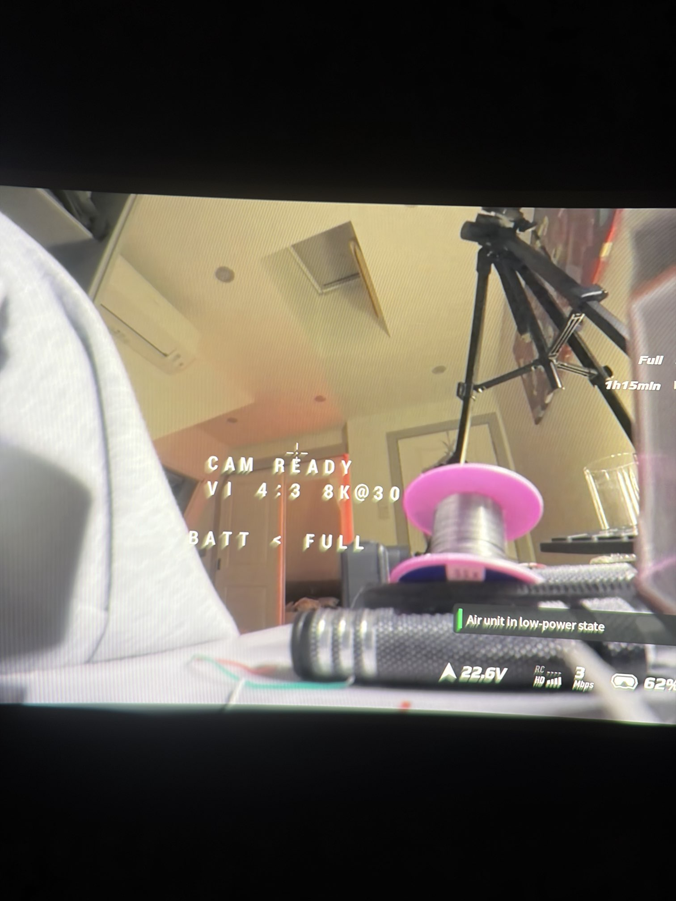
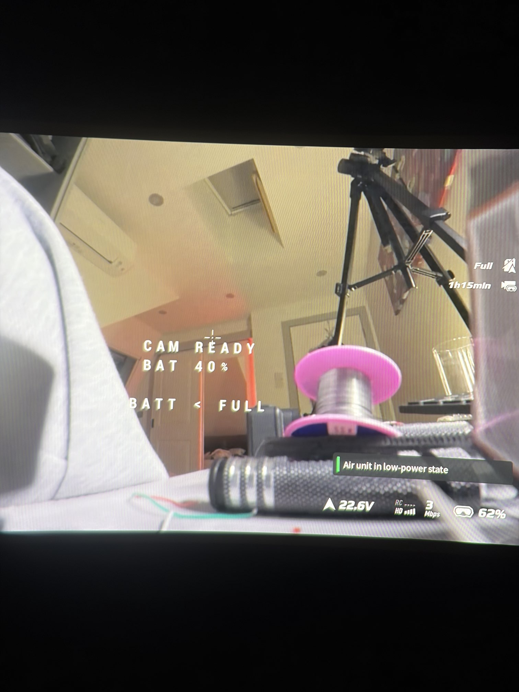

# ESP32 GoPro control for an FPV drone

Setup notes for adding GoPro recording control and live camera status to my custom FPV drone, using an ESP32-C3 SuperMini running the RECon32 firmware.

## Credit

The firmware is [RECon32](https://recon32.es/), free community software by its own developer. I did not write it, and its firmware files are not in this repo. This repo documents how I integrated it with my drone.

## What it does

- The ESP32 connects to a UART on the flight controller and talks to Betaflight over MSP
- A switch on my radio transmitter starts and stops GoPro recording
- Camera status shows up in the OSD in my goggles

## Result

Camera status in the goggles OSD: CAM READY and the camera mode.

The same status line with the camera battery level.

## What I did

- Flashed the ESP32-C3 SuperMini with RECon32 using its web installer
- Wired the ESP32 to a free UART on the flight controller
- Set up a radio channel and the Betaflight OSD so a transmitter switch controls recording and status appears in the goggles
- Paired the ESP32 with the GoPro

## Status

Wiring details to be added.
